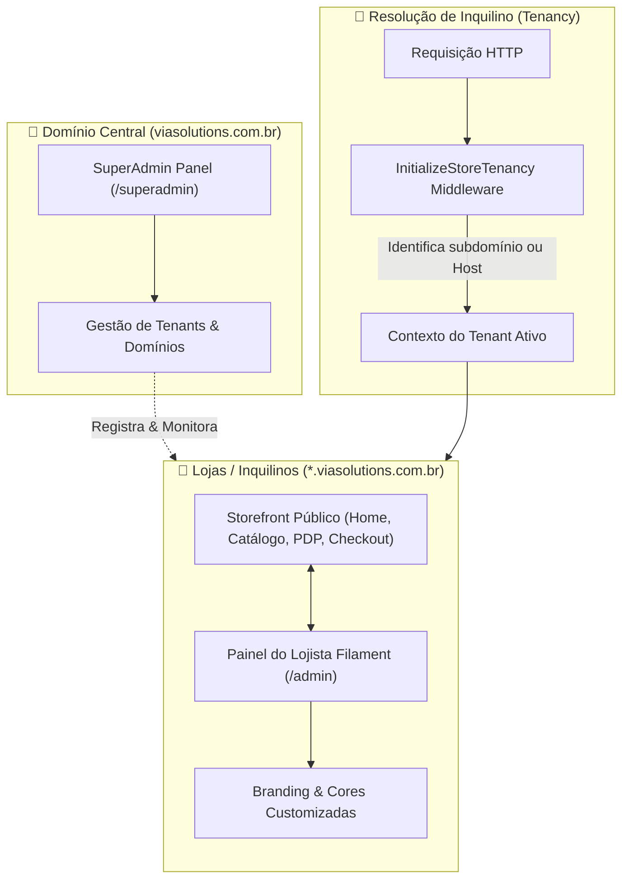

<div align="center">

# 🛒 ViaEcommerce
### Plataforma SaaS E-commerce Multi-Tenant & White-Label de Alta Performance

[](https://php.net)
[](https://laravel.com)
[](https://filamentphp.com)
[](https://tailwindcss.com)
[](https://www.docker.com/)
[](https://www.mysql.com/)
[](https://redis.io/)
[](LICENSE)

<br/>

<p align="center">
  <b>ViaEcommerce</b> é uma solução completa para comércio eletrônico multi-inquilino (Multi-Tenancy) que permite hospedar e gerenciar múltiplas lojas virtuais independentes em uma infraestrutura centralizada e escalável, com suporte a personalização visual completa (White-Label) e painéis administrativos modernos.
</p>

[Visão Geral](#-visão-geral) •
[Funcionalidades](#-funcionalidades-principais) •
[Arquitetura](#-arquitetura-do-ecossistema) •
[Guia Rápido](#-instalação-e-execução) •
[Credenciais](#-acessos-e-credenciais-de-teste) •
[Comandos Úteis](#-comandos-úteis)

</div>

---

## 🌟 Visão Geral

O **ViaEcommerce** foi arquitetado sob o conceito de **Software as a Service (SaaS)** multi-inquilino. O sistema desacopla a administração global das operações individuais de cada lojista:

- **SuperAdmin Central**: Gestão operacional de tenants, acompanhamento de assinaturas, controle de status (ativo/pausado) e monitoramento geral da plataforma.
- **Tenant Admin**: Painel administrativo individual alimentado por **Filament v3**, permitindo que cada lojista gerencie seu catálogo, estoque, variações, pedidos, clientes e customização de layout.
- **Storefront de Alta Conversão**: Vitrine virtual rápida, responsiva e elegante construída com Blade e Tailwind CSS, otimizada para SEO, busca instantânea e checkout simplificado.

---

## ✨ Funcionalidades Principais

### 🏢 Multi-Tenancy Inteligente
- **Isolamento de Dados**: Escopo e contexto definidos por tenant com suporte nativo a subdomínios dinâmicos (ex: `loja1.viasolutions.com.br`) e domínios personalizados.
- **Ciclo de Vida do Tenant**: Ativação, suspensão e modo de manutenção customizável com tela informativa automática (`tenant-paused`).

### 🛡️ Painel SuperAdmin (`/superadmin`)
- Controle centralizado de todas as empresas e lojistas.
- Gerenciamento de planos, subdomínios vinculados e dados cadastrais.
- Dashboard consolidado com métricas de uso da plataforma.

### ⚙️ Painel do Lojista (`/admin`)
- **Catálogo & Estoque**: Cadastro de produtos simples e com grade de variações (tamanhos, cores, SKUs e preços).
- **Categorias & Banners**: Organização do catálogo e publicação de campanhas promocionais.
- **Gestão de Pedidos**: Fluxo completo de faturamento, tracking de entrega e histórico de atualizações.
- **CRM de Clientes & LGPD**: Cadastro automático via checkout com registro explícito de consentimento e termos de privacidade (LGPD).

### 🎨 White-Label & Personalização de Marca
- Ajuste de identidade visual por loja: upload de logo, favicon e banners.
- Configuração de paleta de cores primária e secundária.
- Definição de dados de contato, WhatsApp e links de redes sociais diretamente pelo painel.

### 🛍️ Storefront Moderno & Otimizado
- **Busca Preditiva**: Sugestões em tempo real via endpoint `/api/busca-preditiva` com debounce.
- **Mini-Cart Interativo**: Gaveta lateral para adição, alteração de quantidades e remoção ágil de itens.
- **Cálculo Dinâmico de Frete**: Integração para cálculo instantâneo de frete por CEP (`/api/calcular-frete`).
- **Checkout Seguro**: Fluxo simplificado com suporte a métodos de pagamento (PIX, Cartão de Crédito e Boleto).

---

## 🏗️ Arquitetura do Ecossistema



---

## 🛠️ Stack Tecnológica

| Camada | Tecnologias Utilizadas |
| :--- | :--- |
| **Backend** | [PHP 8.3](https://php.net) • [Laravel 11+](https://laravel.com) |
| **Painéis Administrativos** | [Filament v3](https://filamentphp.com) • [Livewire 3](https://livewire.laravel.com) |
| **Multi-Tenancy** | [Stancl/Tenancy v3](https://tenancyforlaravel.com) |
| **Frontend** | [Blade](https://laravel.com/docs/blade) • [Tailwind CSS](https://tailwindcss.com) • [Vite](https://vitejs.dev) |
| **Banco de Dados** | [MySQL 8.4](https://www.mysql.com) |
| **Cache, Sessões & Filas** | [Redis 7 Alpine](https://redis.io) |
| **Servidor Web & Proxy** | [Nginx Alpine](https://nginx.org) |
| **Containerização** | [Docker](https://www.docker.com) & [Docker Compose](https://docs.docker.com/compose/) |
| **Qualidade & Testes** | [PHPUnit](https://phpunit.de) • [Laravel Pint](https://laravel.com/docs/pint) |

---

## 🚀 Instalação e Execução

### Pré-requisitos
- [Docker](https://www.docker.com/products/docker-desktop/) & [Docker Compose](https://docs.docker.com/compose/install/) instalados
- [Git](https://git-scm.com/)

### 1. Clonar o Repositório
```bash
git clone https://github.com/seu-usuario/via-ecommerce.git
cd via-ecommerce
```

### 2. Configuração de Ambiente
Copie o arquivo de exemplo e ajuste as variáveis se necessário:
```bash
cp .env.example .env
```

### 3. Subir os Containers Docker
```bash
docker compose up -d
```

### 4. Instalar Dependências e Executar Migrações
Execute o setup automatizado dentro do container da aplicação:
```bash
docker compose exec app composer setup
```
Ou manualmente em etapas:
```bash
docker compose exec app composer install
docker compose exec app php artisan key:generate
docker compose exec app php artisan migrate --force
docker compose exec app php artisan db:seed
docker compose exec app npm install
docker compose exec app npm run build
```

---

## 🔑 Acessos e Credenciais de Teste

Após rodar o comando de seed (`php artisan db:seed`), os seguintes acessos estarão configurados:

| Painel / Módulo | URL Local | E-mail | Senha | Perfil |
| :--- | :--- | :--- | :--- | :--- |
| **SuperAdmin** | [`http://localhost:8088/superadmin`](http://localhost:8088/superadmin) | `superadmin@viasolutions.com.br` | `superadmin123` | Administrador Global |
| **Admin da Loja** | [`http://localhost:8088/admin`](http://localhost:8088/admin) | `admin@elisie.com.br` | `admin123` | Lojista (Elisie Concept) |
| **Loja Storefront** | [`http://localhost:8088`](http://localhost:8088) | *Público* | *Público* | Cliente / Consumidor |

> [!TIP]
> **Acesso via Subdomínios**: Para testar a resolução de subdomínios no ambiente local, adicione entradas no seu arquivo `hosts` (ex: `127.0.0.1 elisie.viasolutions.local`) ou utilize serviços com wildcard DNS (ex: `nip.io` ou `lvh.me`).

---

## 💻 Comandos Úteis

<details>
<summary><b>🧪 Executar Testes Automatizados</b></summary>

```bash
# Executar todos os testes
docker compose exec app php artisan test

# Executar suíte de testes com formato compacto
docker compose exec app php artisan test --compact

# Executar teste específico (ex: MultiTenancy)
docker compose exec app php artisan test --filter=MultiTenancyAndSuperAdminTest
```
</details>

<details>
<summary><b>🎨 Padronização de Código (Laravel Pint)</b></summary>

```bash
# Formatar o código seguindo as convenções do projeto
docker compose exec app vendor/bin/pint --format agent
```
</details>

<details>
<summary><b>⚡ Cache & Otimizações</b></summary>

```bash
# Limpar caches de configuração, rotas e views
docker compose exec app php artisan optimize:clear

# Aplicar caches de produção
docker compose exec app php artisan optimize
```
</details>

<details>
<summary><b>🐳 Gerenciamento dos Containers</b></summary>

```bash
# Visualizar logs em tempo real
docker compose logs -f app web

# Reiniciar containers
docker compose restart

# Parar serviços
docker compose down
```
</details>

---

## 📁 Estrutura do Projeto

```text
ViaEcommerce/
├── app/
│   ├── Filament/                # Recursos e Páginas Administrativas (Filament)
│   │   ├── Pages/               # Páginas customizadas (ex: ManageBranding)
│   │   ├── Resources/           # Catálogo, Banners, Pedidos, Clientes, etc.
│   │   └── SuperAdmin/          # Módulo Central de Gestão de Tenants
│   ├── Http/
│   │   ├── Controllers/         # Controladores da vitrine (Cart, Catalog, Checkout, etc.)
│   │   └── Middleware/          # Resolução e escopo de Tenancy
│   ├── Models/                  # Modelos Eloquent (Tenant, Product, Order, Customer, etc.)
│   └── Providers/               # Provedores de Serviço e Painéis Filament
├── config/                      # Configurações do Laravel e Tenancy
├── database/
│   ├── migrations/              # Migrações do banco de dados
│   └── seeders/                 # Seeders completos com dados de teste
├── docker/                      # Dockerfiles e configurações Nginx e PHP-FPM
├── resources/
│   ├── css/                     # Estilos Tailwind CSS
│   ├── js/                      # Scripts e componentes de storefront
│   └── views/                   # Templates Blade (Storefront, Components, Layouts)
├── routes/
│   ├── web.php                  # Rotas da vitrine e autenticação
│   └── console.php              # Comandos artisan customizados
├── tests/
│   └── Feature/                 # Testes de integração, CRM, LGPD e MultiTenancy
├── docker-compose.yml           # Ambiente local de desenvolvimento
├── docker-compose.prod.yml      # Ambiente preparado para produção
└── README.md                    # Documentação do projeto
```

---

## 📄 Licença

Este projeto é distribuído sob a licença **MIT**. Consulte o arquivo [LICENSE](LICENSE) para mais detalhes.

---

<div align="center">
  <sub>Construído com excelência pela equipe <b>ViaSolutions</b>.</sub>
</div>
